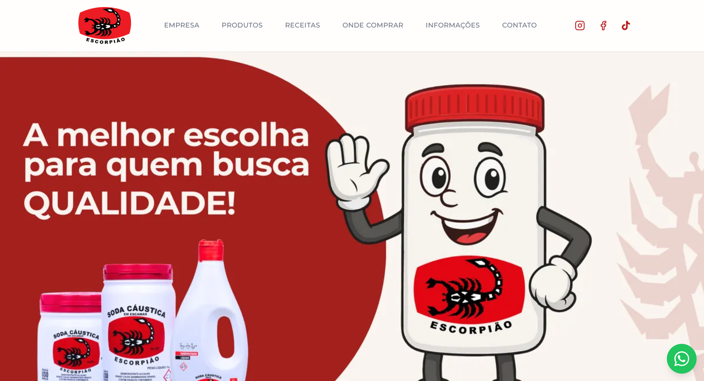
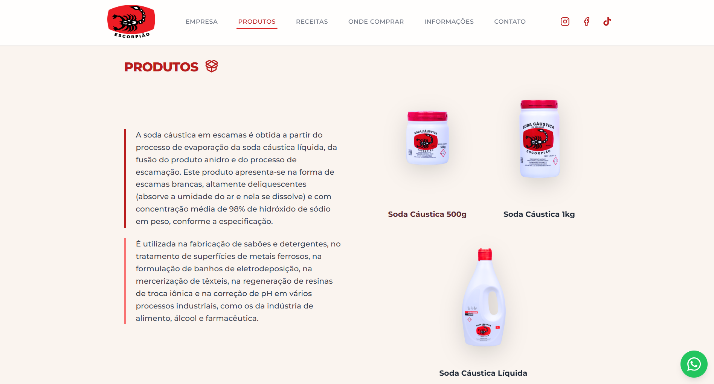
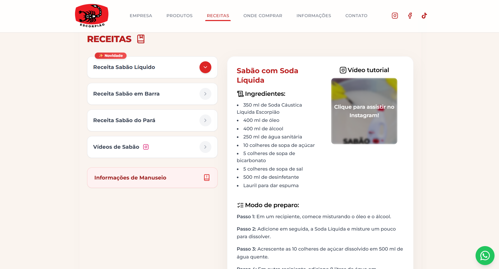
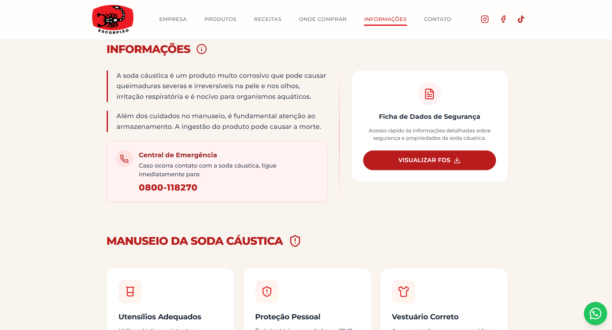
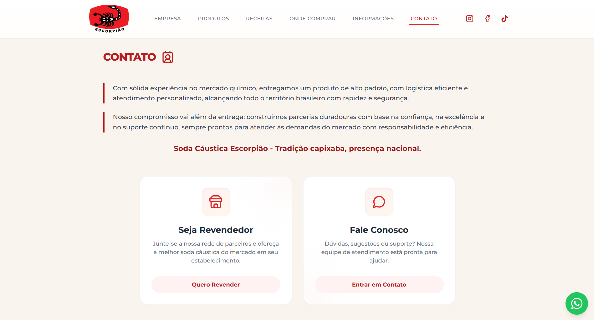
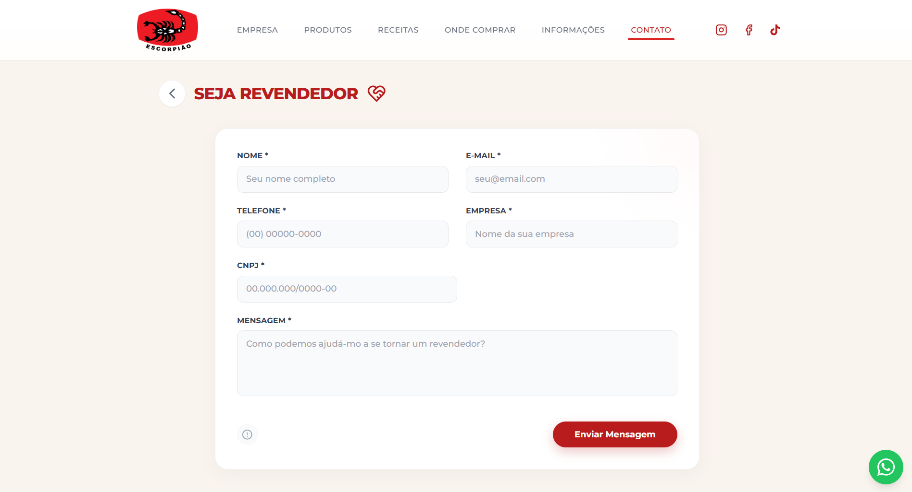
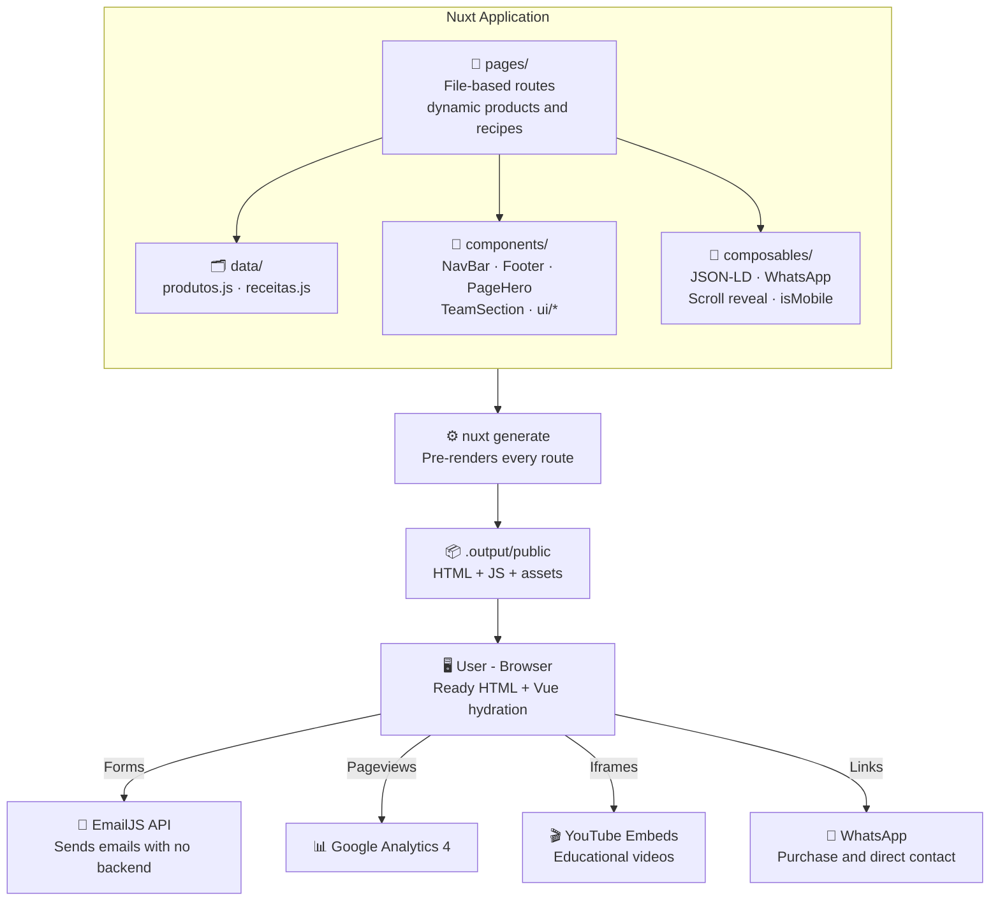

<p align="center">
  <h1 align="center">🦂 Soda Cáustica Escorpião — Institutional Website</h1>
  <p align="center">
    A modern, responsive institutional website built from scratch for a chemical industry with over 50 years of tradition.
    <br/>
    <strong>Nuxt 3 · Vue.js 3 · Tailwind CSS 3 · EmailJS · Lucide Icons</strong>
  </p>
</p>

<p align="center">
  
  
  
  
  
  
</p>

---

## 📋 About the Project

An institutional website built for **Soda Cáustica Escorpião**, a chemical industry founded in **1971** in the city of Vitória – ES, a national reference in the caustic soda segment. The project showcases the company, its products, homemade soap recipes, points of sale, and contact channels, all with a modern interface, fluid animations, and a responsive experience.

The site is built with **Nuxt 3** and deployed as a **static site (SSG)**: `nuxt generate` pre-renders every route to HTML, which improves SEO and load time. It needs no backend, database, or dedicated server, so it can be hosted on any static file platform.

**🌐 Live project:** [sodaescorpiao.com.br](https://sodaescorpiao.com.br)

### 📸 Preview

<table>
  <tr>
    <td align="center"><br/><sub>Home / Landing Page</sub></td>
    <td align="center"><br/><sub>Products Section</sub></td>
    <td align="center"><br/><sub>Recipes Section</sub></td>
  </tr>
  <tr>
    <td align="center"><br/><sub>Information & Handling</sub></td>
    <td align="center"><br/><sub>Contact Hub</sub></td>
    <td align="center"><br/><sub>Contact Form</sub></td>
  </tr>
</table>

---

## ✨ Features

### 🗺️ Pages

| Route | Content |
|---|---|
| `/` | Home: rotating banner, company figures, Company section, product lines, recipes, team and Where to Buy |
| `/nossa-historia` | Company history since the 1970s |
| `/produtos` | Catalog with both lines (Caustic Soda and Escorpião Casa) |
| `/produto/[slug]` | One page per product: description, technical info, safety, SDS and WhatsApp purchase |
| `/linha/soda-caustica` · `/linha/escorpiao-casa` | Product line pages |
| `/receitas` · `/receita/[slug]` | Homemade soap recipes, each with its own page |
| `/info` | Safety Data Sheets (SDS) as PDF, handling guide, emergency center and educational videos |
| `/contato` | Contact channels and Contact Us form (EmailJS) |
| `/contato/revendedor` | Become a Reseller form (EmailJS) |
| `/contato/obrigado` | Submission confirmation (excluded from search indexing) |
| `/politica-de-privacidade` · `/termos-de-uso` | Legal pages |

Old URLs keep working through redirects: `/contato/fale-conosco`, `/onde-comprar`, `/soda-caustica` and `/escorpiao-casa`.

### 🔎 SEO
- Pre-rendered HTML on every route, with `lang="pt-BR"`, per-page title, description and Open Graph
- `sitemap.xml` and `robots.txt` generated automatically (`@nuxtjs/sitemap` and `@nuxtjs/robots`)
- Schema.org structured data (JSON-LD): organization, products, recipes and breadcrumbs

### 📊 Analytics
- Google Analytics 4 (gtag.js), with pageviews on in-site navigation as well

### 🎨 Design & UX
- **Color design tokens** centralized in `assets/css/tokens.css`
- **Reusable UI components** (`Badge`, `BaseButton`, `Card`, `SectionHeader`, `StatCard`)
- **Scroll animations** with Intersection Observer (reveal, scale, slide)
- **Fixed navbar** with a products menu and mobile menu
- **Floating WhatsApp button** for direct contact
- **Footer** with full address, emergency phone, CNPJ (Tax ID), social media and legal links
- **Typography**: Google Fonts Montserrat (400 to 800)
- **Fully responsive**: desktop, tablet and mobile

---

## 🛠️ Tech Stack

| Technology | Usage |
|---|---|
| **Nuxt 3** | Vue framework with file-based routing, SSR and static generation |
| **Vue.js 3** | Composition API (`<script setup>`) |
| **Tailwind CSS 3.4** | Responsive utility-first styling (`@nuxtjs/tailwindcss`) |
| **@nuxtjs/sitemap** · **@nuxtjs/robots** | Sitemap and robots.txt generated at build time |
| **EmailJS** | Sends emails directly from the frontend (no backend) |
| **Lucide Vue Next** | SVG icon library |
| **Sharp** | Image optimization script (WebP conversion) |
| **Google Fonts** | Typography: Montserrat |

---

## 🏗️ Architecture



---

## 📂 Project Structure

```
project_escorpiao/
│
└── frontend/
    ├── nuxt.config.ts                # Nuxt config: modules, SEO, redirects, EmailJS and GA
    ├── tailwind.config.cjs           # Tailwind configuration
    ├── package.json                  # Dependencies and scripts
    ├── optimize-images.js            # Image optimization script (Sharp → WebP)
    ├── app.vue                       # Root component + organization JSON-LD
    ├── error.vue                     # Error / 404 page
    │
    ├── app/router.options.ts         # Scroll behavior (smooth scrolling to anchors)
    ├── layouts/default.vue           # Default layout (NavBar + page + Footer + WhatsApp)
    ├── pages/                        # One route per file (see the pages table)
    ├── components/                   # NavBar, Footer, PageHero, TeamSection, RecipeDetails, WhatsappButton
    │   └── ui/                       # Badge, BaseButton, Card, SectionHeader, StatCard
    ├── composables/                  # useJsonLd, useWhatsapp, useScrollReveal, useIsMobile
    ├── data/                         # Product and recipe data
    ├── plugins/gtag.client.ts        # GA4 pageviews on in-site navigation
    │
    ├── assets/
    │   ├── css/tokens.css            # Design tokens (colors)
    │   ├── empresa/ identidade/ local/ nossa-equipe/
    │   └── produto/ receitas/ ondeComprar/
    │
    └── public/
        ├── IconeEscorpiaoQuadrado.png   # Favicon
        └── static/uploads/              # Safety Data Sheet (SDS) PDFs
```

> The PDFs `FDS-ESCORPIAO-2026-ATUALIZADA.pdf` and `FDS-ESCORPIAO-ESCAMA-2025.pdf` are copies of `FDS-ESCORPIAO-LIQUIDA.pdf` and `FDS-ESCORPIAO-ESCAMA.pdf`, kept so old links don't break. When updating an SDS, update both copies.

---

## 🖼️ Image Optimization

The project includes a custom image optimization script using **Sharp**:

```
Original Image (JPG/PNG)
  ↓
Sharp (Node.js)
  ├── Smart resize (800px for grid, 1200px for cover)
  ├── Conversion to WebP (quality 80)
  └── Output: file-opt.webp
```

Resulting in a **70–90% reduction in file size** with no perceptible loss of quality.

---

## 🎬 Animations & Micro-interactions

The site uses a robust scroll animation system based on the **Intersection Observer API**:

| Type | Effect | Usage |
|---|---|---|
| `reveal-element` | Fade in + slide up | Text and titles |
| `reveal-scale` | Fade in + scale up | Cards and images |
| `reveal-left` | Fade in + slide left | Recipe buttons |
| `icon-float` | Continuous floating | Mission/Vision/Values icons |
| `slide-fade` | Slide + fade (Vue transition) | Recipe content switching |
| `expand` | Smooth accordion | Recipes on mobile |

Each animation uses **staggered delays** (100ms–600ms) to create smooth cascade effects.

---

## 🚀 How to Run the Project

### Prerequisites

- **Node.js** version 20 or higher → [Download](https://nodejs.org/)
- **npm** (already comes with Node.js)

### Step by step

```bash
# 1. Clone the repository
git clone https://github.com/Xavis01/project_escorpiao.git

# 2. Enter the frontend folder
cd project_escorpiao/frontend

# 3. Install dependencies (exact versions from package-lock.json)
npm ci

# 4. Start the development server
npm run dev
```

The site will be available at `http://localhost:3000` 🎉

### Other useful commands

```bash
# Generate the production static site (output in .output/public)
npm run generate

# Serve the generated output locally
npx serve .output/public

# Optimize images (generates WebP versions)
node optimize-images.js
```

> **💡 Note:** Deployment is static: just publish the `.output/public` folder. There is no backend, database, or environment variables to configure.

---

## 📱 Responsiveness

The site was built with a **mobile-first** approach, ensuring a perfect display on:

- 📱 **Mobile** (< 768px) — Hamburger menu, accordion for recipes, stacked layout
- 📊 **Tablet** (768px–1024px) — Adapted grid, hybrid navigation
- 🖥️ **Desktop** (> 1024px) — Full layout with scroll spy, recipes in a side panel

---

## 🔗 Integrations

| Service | Usage |
|---|---|
| **EmailJS** | Sends contact and reseller forms (directly from the frontend, no backend) |
| **YouTube** | Embedded educational videos (PPE, recipes) |
| **Instagram** | Links to soap recipe reels |
| **WhatsApp** | Floating direct contact button |
| **Google Analytics 4** | Page view tracking |
| **Google Fonts** | Montserrat typography |

---

## 👨‍💻 Author

**Lucas Xavier**

---

<p align="center">
  <sub>Built with dedication — from design to deployment. 🚀</sub>
</p>
