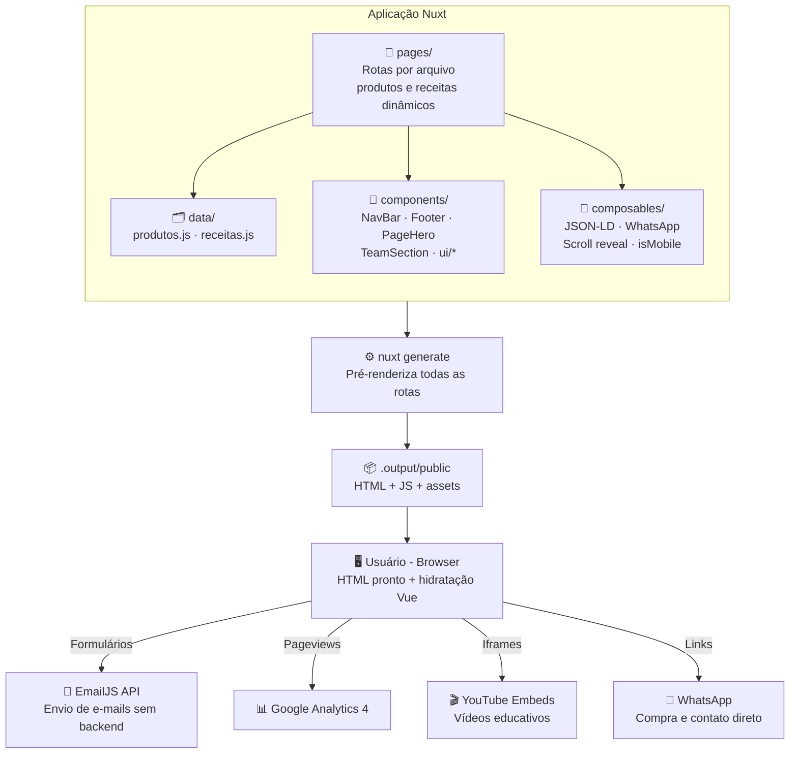

<p align="center">
  <h1 align="center">🦂 Soda Cáustica Escorpião — Site Institucional</h1>
  <p align="center">
    Site institucional moderno e responsivo desenvolvido do zero para uma indústria química com mais de 50 anos de tradição.
    <br/>
    <strong>Nuxt 3 · Vue.js 3 · Tailwind CSS 3 · EmailJS · Lucide Icons</strong>
  </p>
</p>

<p align="center">
  
  
  
  
  
  
</p>

---

## 📋 Sobre o Projeto

Site institucional desenvolvido para a **Soda Cáustica Escorpião**, indústria química fundada em **1971** na cidade de Vitória – ES, referência nacional no segmento de soda cáustica. O projeto apresenta a empresa, seus produtos, receitas de sabão caseiro, pontos de venda e canais de contato, tudo com uma interface moderna, animações fluidas e experiência responsiva.

O site é feito em **Nuxt 3** e publicado como **site estático (SSG)**: o `nuxt generate` pré-renderiza cada rota em HTML, o que melhora SEO e carregamento. Não precisa de backend, banco de dados nem servidor dedicado, então dá pra hospedar em qualquer plataforma de arquivos estáticos.

**🌐 Projeto em produção:** [sodaescorpiao.com.br](https://sodaescorpiao.com.br)

### 📸 Preview

<table>
  <tr>
    <td align="center"><br/><sub>Home / Landing Page</sub></td>
    <td align="center"><br/><sub>Seção Produtos</sub></td>
    <td align="center"><br/><sub>Seção Receitas</sub></td>
  </tr>
  <tr>
    <td align="center"><br/><sub>Informações & Manuseio</sub></td>
    <td align="center"><br/><sub>Hub de Contato</sub></td>
    <td align="center"><br/><sub>Formulário de Contato</sub></td>
  </tr>
</table>

---

## ✨ Funcionalidades

### 🗺️ Páginas

| Rota | Conteúdo |
|---|---|
| `/` | Home: banner rotativo, números da empresa, seção Empresa, linhas de produto, receitas, equipe e Onde Comprar |
| `/nossa-historia` | História da empresa desde a década de 70 |
| `/produtos` | Catálogo com as duas linhas (Soda Cáustica e Escorpião Casa) |
| `/produto/[slug]` | Página de cada produto: descrição, informações técnicas, segurança, FDS e compra pelo WhatsApp |
| `/linha/soda-caustica` · `/linha/escorpiao-casa` | Páginas das linhas de produto |
| `/receitas` · `/receita/[slug]` | Receitas de sabão caseiro, cada uma com página própria |
| `/info` | Fichas de Dados de Segurança (FDS) em PDF, guia de manuseio, central de emergência e vídeos educativos |
| `/contato` | Canais de contato e formulário Fale Conosco (EmailJS) |
| `/contato/revendedor` | Formulário Seja Revendedor (EmailJS) |
| `/contato/obrigado` | Confirmação de envio (fora do índice de busca) |
| `/politica-de-privacidade` · `/termos-de-uso` | Páginas legais |

Endereços antigos continuam funcionando por redirect: `/contato/fale-conosco`, `/onde-comprar`, `/soda-caustica` e `/escorpiao-casa`.

### 🔎 SEO
- HTML pré-renderizado em todas as rotas, com `lang="pt-BR"`, título, descrição e Open Graph por página
- `sitemap.xml` e `robots.txt` gerados automaticamente (`@nuxtjs/sitemap` e `@nuxtjs/robots`)
- Dados estruturados Schema.org (JSON-LD): organização, produtos, receitas e breadcrumbs

### 📊 Analytics
- Google Analytics 4 (gtag.js), com pageview também nas navegações internas do site

### 🎨 Design & UX
- **Design tokens** de cor centralizados em `assets/css/tokens.css`
- **Componentes de UI** reutilizáveis (`Badge`, `BaseButton`, `Card`, `SectionHeader`, `StatCard`)
- **Scroll animations** com Intersection Observer (reveal, scale, slide)
- **Navbar fixa** com menu de produtos e menu mobile
- **Botão flutuante WhatsApp** para contato direto
- **Footer** com endereço completo, telefone de emergência, CNPJ, redes sociais e links legais
- **Tipografia**: Google Fonts Montserrat (400 a 800)
- **Totalmente responsivo**: desktop, tablet e mobile

---

## 🛠️ Stack Tecnológica

| Tecnologia | Uso |
|---|---|
| **Nuxt 3** | Framework Vue com roteamento por arquivos, SSR e geração estática |
| **Vue.js 3** | Composition API (`<script setup>`) |
| **Tailwind CSS 3.4** | Estilização utilitária responsiva (`@nuxtjs/tailwindcss`) |
| **@nuxtjs/sitemap** · **@nuxtjs/robots** | Sitemap e robots.txt gerados no build |
| **EmailJS** | Envio de e-mails direto do frontend (sem backend) |
| **Lucide Vue Next** | Biblioteca de ícones SVG |
| **Sharp** | Script de otimização de imagens (conversão para WebP) |
| **Google Fonts** | Tipografia: Montserrat |

---

## 🏗️ Arquitetura



---

## 📂 Estrutura do Projeto

```
project_escorpiao/
│
└── frontend/
    ├── nuxt.config.ts                # Configuração do Nuxt: módulos, SEO, redirects, EmailJS e GA
    ├── tailwind.config.cjs           # Configuração do Tailwind
    ├── package.json                  # Dependências e scripts
    ├── optimize-images.js            # Script de otimização de imagens (Sharp → WebP)
    ├── app.vue                       # Componente raiz + JSON-LD da organização
    ├── error.vue                     # Página de erro / 404
    │
    ├── app/router.options.ts         # Scroll behavior (âncoras com rolagem suave)
    ├── layouts/default.vue           # Layout padrão (NavBar + página + Footer + WhatsApp)
    ├── pages/                        # Uma rota por arquivo (ver tabela de páginas)
    ├── components/                   # NavBar, Footer, PageHero, TeamSection, RecipeDetails, WhatsappButton
    │   └── ui/                       # Badge, BaseButton, Card, SectionHeader, StatCard
    ├── composables/                  # useJsonLd, useWhatsapp, useScrollReveal, useIsMobile
    ├── data/                         # Dados dos produtos e das receitas
    ├── plugins/gtag.client.ts        # Pageviews do GA4 em navegação interna
    │
    ├── assets/
    │   ├── css/tokens.css            # Design tokens (cores)
    │   ├── empresa/ identidade/ local/ nossa-equipe/
    │   └── produto/ receitas/ ondeComprar/
    │
    └── public/
        ├── IconeEscorpiaoQuadrado.png   # Favicon
        └── static/uploads/              # PDFs das Fichas de Dados de Segurança (FDS)
```

> Os PDFs `FDS-ESCORPIAO-2026-ATUALIZADA.pdf` e `FDS-ESCORPIAO-ESCAMA-2025.pdf` são cópias de `FDS-ESCORPIAO-LIQUIDA.pdf` e `FDS-ESCORPIAO-ESCAMA.pdf`, mantidas para não quebrar links antigos. Ao atualizar uma FDS, atualize as duas cópias.

---

## 🖼️ Otimização de Imagens

O projeto inclui um script customizado de otimização de imagens utilizando **Sharp**:

```
Imagem Original (JPG/PNG)
  ↓
Sharp (Node.js)
  ├── Resize inteligente (800px para grid, 1200px para capa)
  ├── Conversão para WebP (quality 80)
  └── Output: arquivo-opt.webp
```

Resultando em **redução de 70–90% no tamanho dos arquivos** sem perda perceptível de qualidade.

---

## 🎬 Animações & Micro-interações

O site utiliza um sistema robusto de scroll animations baseado na **Intersection Observer API**:

| Tipo | Efeito | Uso |
|---|---|---|
| `reveal-element` | Fade in + slide up | Textos e títulos |
| `reveal-scale` | Fade in + scale up | Cards e imagens |
| `reveal-left` | Fade in + slide left | Botões de receitas |
| `icon-float` | Flutuação contínua | Ícones de Missão/Visão/Valores |
| `slide-fade` | Slide + fade (Vue transition) | Troca de conteúdo de receitas |
| `expand` | Accordion smooth | Receitas no mobile |

Cada animação utiliza **delays staggered** (100ms–600ms) para criar efeitos cascata suaves.

---

## 🚀 Como Rodar o Projeto

### Pré-requisitos

- **Node.js** versão 20 ou superior → [Download](https://nodejs.org/)
- **npm** (já vem com o Node.js)

### Passo a passo

```bash
# 1. Clone o repositório
git clone https://github.com/Xavis01/project_escorpiao.git

# 2. Entre na pasta do frontend
cd project_escorpiao/frontend

# 3. Instale as dependências (exatamente as versões do package-lock.json)
npm ci

# 4. Inicie o servidor de desenvolvimento
npm run dev
```

O site estará disponível em `http://localhost:3000` 🎉

### Outros comandos úteis

```bash
# Gerar o site estático de produção (saída em .output/public)
npm run generate

# Servir localmente o resultado do generate
npx serve .output/public

# Otimizar imagens (gera versões WebP)
node optimize-images.js
```

> **💡 Nota:** O deploy é estático: basta publicar a pasta `.output/public`. Não há backend, banco de dados ou variáveis de ambiente para configurar.

---

## 📱 Responsividade

O site foi desenvolvido com abordagem **mobile-first**, garantindo perfeita visualização em:

- 📱 **Mobile** (< 768px) — Menu hamburger, accordion para receitas, layout empilhado
- 📊 **Tablet** (768px–1024px) — Grid adaptado, navegação híbrida
- 🖥️ **Desktop** (> 1024px) — Layout completo com scroll spy, receitas em painel lateral

---

## 🔗 Integrações

| Serviço | Uso |
|---|---|
| **EmailJS** | Envio de formulários de contato e revendedor (direto do frontend, sem backend) |
| **YouTube** | Vídeos educativos embeddados (EPIs, receitas) |
| **Instagram** | Links para reels de receitas de sabão |
| **WhatsApp** | Botão flutuante de contato direto |
| **Google Analytics 4** | Medição de visitas |
| **Google Fonts** | Tipografia Montserrat |

---

## 👨‍💻 Autor

**Lucas Xavier**

---

<p align="center">
  <sub>Desenvolvido com dedicação — do design ao deploy. 🚀</sub>
</p>
